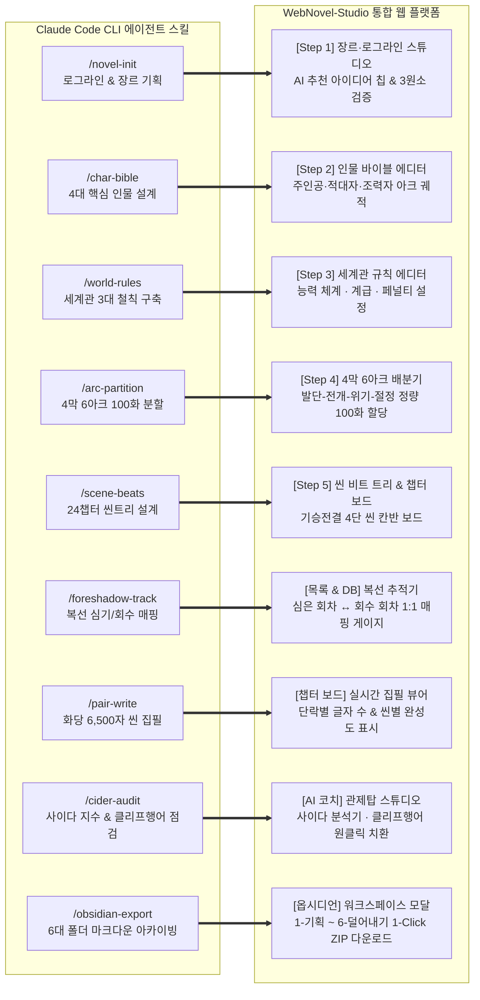
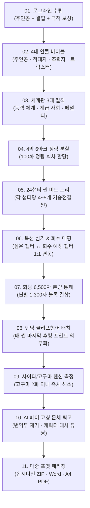

# WebNovel-Studio (웹소설 공학적 창작 & 제작 플랫폼)

> **"클로드 코드(Claude Code)의 스킬(Skills) 체계를 통합 웹 GUI 워크스페이스로 승화시키다."**  
> 100화 완결 4막·6아크·24챕터 공학적 플롯 엔진, 실시간 집필 관제 대시보드, 복선/미결 추적기, 멀티 모델(Gemini · Claude · OpenAI) AI 페어 라이팅 코치가 통합된 차세대 전문 웹소설 창작 플랫폼

[](https://opensource.org/licenses/MIT)
[](https://www.typescriptlang.org/)
[](https://react.dev/)
[](https://expressjs.com/)
[](https://tailwindcss.com/)

---

## 📑 목차
1. [기획 비전: Claude Code Skills의 웹 플랫폼 구현](#1-기획-비전-claude-code-skills의-웹-플랫폼-구현)
2. [Mermaid.js 구조도 및 아키텍처](#2-mermaidjs-구조도-및-아키텍처)
   - 2.1 전체 시스템 아키텍처 (Client-Server-Multi LLM Proxy)
   - 2.2 Claude Code Skills ↔ WebNovel-Studio GUI 매핑 구조도
   - 2.3 11단계 공학적 웹소설 작성 파이프라인
   - 2.4 4막 6아크 24챕터 100화 플롯 & 복선 매핑 흐름도
3. [웹소설 공학적 작성 방법론 (100화 완결 완벽 가이드)](#3-웹소설-공학적-작성-방법론-100화-완결-완벽-가이드)
   - 3.1 1단계: 장르 & 흥행 로그라인 공식 (3원소)
   - 3.2 2단계: 4대 핵심 인물 바이블 구축
   - 3.3 3단계: 세계관 3대 철칙 (Rules of Worldbuilding)
   - 3.4 4단계: 4막 6아크 정량 분할 (기승전결 100화 배분)
   - 3.5 5단계: 24챕터 씬 비트 & 기승전결 4단 씬 분할
   - 3.6 6단계: 화당 6,500자 분량 통제와 단락 구성
   - 3.7 7단계: 씬 엔딩 클리프행어(Hook) 의무화
   - 3.8 8단계: 사이다/고구마 텐션 조절 (2화 이내 카타르시스)
   - 3.9 9단계: 복선(Foreshadowing) 심기와 회수 1:1 매핑
   - 3.10 10단계: AI 페어 라이팅 교정 및 캐릭터 보이스 튜닝
   - 3.11 11단계: 옵시디언 6대 표준 폴더 아카이빙
4. [디자인 시안 및 7대 핵심 UI/UX 레이아웃 가이드](#4-디자인-시안-및-7대-핵심-uiux-레이아웃-가이드)
5. [인터랙티브 기능 및 버튼 구현 명세](#5-인터랙티브-기능-및-버튼-구현-명세)
6. [시작하기 및 로컬 개발 환경](#6-시작하기-및-로컬-개발-환경)

---

## 1. 기획 비전: Claude Code Skills의 웹 플랫폼 구현

### 1.1 배경 및 동기
최근 AI 기반 웹소설 창작 분야에서는 **클로드 코드(Claude Code)** CLI와 커스텀 프롬프트/룰셋(Task Rules, Slash Commands, Markdown Knowledge Base)을 활용하여 소설 기획과 챕터 분할을 자동화하는 시도가 주목받고 있습니다. 그러나 CLI 터미널 환경은:
- 개발자가 아닌 일반 작가에게 높은 진입 장벽을 가지며,
- 전체 100화의 서사 텐션 곡선, 회차별 글자 수, 미회수 복선 현황을 한눈에 조망할 수 있는 **시각적 대시보드(Visual Dashboard)**가 결여되어 있고,
- 복선 심기/회수 매핑과 씬 보드 간의 실시간 상호작용이 어렵다는 한계가 있습니다.

### 1.2 WebNovel-Studio의 해결책
**WebNovel-Studio**는 Claude Code의 파워풀한 스킬 파이프라인을 **직관적인 모던 웹 SPA(React + Express) 플랫폼으로 승화**시켰습니다:
- **CLI 명령어 대신 직관적인 인터랙티브 버튼 & 폼 UI 제공**
- **로컬 파일 시스템 대신 브라우저 LocalStorage 무결성 보장 엔진 + 옵시디언 6대 폴더 자동 동기화**
- **단일 모델 종속 탈피**: Gemini 3.8 Flash (초고속 플롯 생성) + Claude 3.5 Sonnet (문체 감수) + OpenAI GPT-4o (복선 검증) 멀티 모델 스위칭

---

## 2. Mermaid.js 구조도 및 아키텍처

### 2.1 전체 시스템 아키텍처 (Client-Server-Multi LLM Proxy)

```mermaid
flowchart TB
    subgraph Client [클라이언트 프론트엔드 (React 19 + TypeScript + Tailwind CSS)]
        TopGNB[상단 Top GNB\n프로젝트 스위처 · AI 제공자 전환 · PDF 뷰어 · 옵시디언 동기화]
        LeftGNB[좌측 GNB 사이드바\n대시보드 · 100화 타임라인 · 씬보드 · 복선DB · 5단계 플롯 메이커]
        
        subgraph Viewports [중앙 뷰포트 라우팅]
            V1[View A: 메인 관제 대시보드]
            V2[View B: 4막 6아크 마스터 타임라인]
            V3[View C: 작품 개요 & 스토리 바이블]
            V4[View D: 24챕터 씬 보드 기승전결]
            V5[View E: 복선 & 미결 과제 추적 DB]
            V6[View F: 5단계 공학적 소설 생성기]
            V7[View G: AI 페어 라이팅 코치 관제탑]
        end

        subgraph Modals [레이어 모달 시스템]
            M1[PdfExportModal - A4 규격 출력]
            M2[WorkspaceModal - 옵시디언 6대 폴더]
            M3[AiSettingsModal - API 키 등록]
        end
    end

    subgraph Backend [서버 백엔드 (Node.js Express + TSX / Port 3000)]
        ServerRouter[/api 라우터 프록시]
        TimeoutGuard[withTimeout 지능형 타임아웃 레이어\n3.5s ~ 5s 한도 내 안정적 Fallback 보증]
        ViteMiddleware[Vite Middleware Mode\nhmr: false - WebSocket 충돌 원천 차단]
        DataZipper[Archiver: 옵시디언 6대 폴더 ZIP 패키징]
    end

    subgraph AIEngine [멀티 파운데이션 AI 게이트웨이]
        Gemini[Google Gemini 3.8 Flash\n초고속 100화 씬트리 & 플롯 비트 생성]
        Claude[Anthropic Claude 3.5 Sonnet\n캐릭터 보이스 튜닝 및 문체 감수]
        OpenAI[OpenAI GPT-4o\n복선 인과관계 및 개연성 검증]
    end

    Client <-->|REST API & JSON| Backend
    Backend <-->|API Proxy| AIEngine
```

---

### 2.2 Claude Code Skills ↔ WebNovel-Studio GUI 매핑 구조도

클로드 코드(Claude Code)의 각 전문 스킬이 WebNovel-Studio의 GUI 기능과 어떻게 1:1 매핑되어 작동하는지를 나타냅니다:



---

### 2.3 11단계 공학적 웹소설 작성 파이프라인



---

### 2.4 4막 6아크 24챕터 100화 플롯 & 복선 매핑 흐름도

```mermaid
gantt
    title 100화 완결 4막 6아크 타임라인 및 복선 수명 주기
    dateFormat  X
    axisFormat %s화

    section 제1막: 발단 (01~16화)
    ARC-01 각성과 시작 (ch01~ch04)         :active, 1, 16
    복선 심기 (세계관 이면의 떡밥 #1)       :milestone, 4, 0

    section 제2막: 전개 (17~50화)
    ARC-02 급성장과 첫 충돌 (ch05~ch08)     :17, 32
    1차 사이다 보상 (중간보스 제압)        :crit, 30, 32
    ARC-03 세계관의 확장 (ch09~ch12)       :33, 50
    복선 심기 (적대자의 정체 #2)           :milestone, 38, 0

    section 제3막: 위기 & 절정 (51~84화)
    ARC-04 배신과 최대 위기 (ch13~ch16)     :51, 68
    ARC-05 대반격과 각성 (ch17~ch20)       :active, 69, 84
    떡밥 #1, #2 대규모 회수 & 카타르시스    :crit, 78, 84

    section 제4막: 결말 (85~100화)
    ARC-06 최종 결전과 완결 (ch21~ch24)    :85, 100
    최종 흑막 처단 및 에필로그             :milestone, 100, 0
```



---

## 3. 웹소설 공학적 작성 방법론 (100화 완결 완벽 가이드)

### 3.1 1단계: 장르 & 흥행 로그라인 공식 (3원소)
웹소설 독자는 3초 안에 작품을 읽을지 결정합니다. 로그라인은 반드시 아래 **3원소 공식**을 만족해야 합니다:
$$\text{로그라인} = [\text{주인공의 상태/신분}] + [\text{감당 불가능한 핵심 결핍/위기}] + [\text{독창적 능력/시스템을 통한 극적 보상}]$$
- **예시**: *"최하급 헌터로 멸시받던 주인공이(신분), 던전 붕괴로 죽음의 문턱에 섰을 때(위기), 오직 자신에게만 보이는 '퀘스트 윈도우'를 각성하여(능력) 세계 유일의 신화급 헌터로 거듭난다(보상)."*

### 3.2 2단계: 4대 핵심 인물 바이블 구축
인물은 단순한 외형 묘사가 아닌 **이야기 내에서의 명확한 기능**을 가져야 합니다:
1. **주인공 (Protagonist)**: 명확한 결핍과 타협할 수 없는 하나의 궁극적 목표(욕망).
2. **적대자 (Antagonist)**: 주인공과 가치관이 정면으로 충돌하며, 주인공을 성장시키는 압도적 벽.
3. **조력자 (Ally)**: 주인공의 결핍된 영역(지략, 자금, 정보)을 보완하고 감정적 유대를 형성.
4. **트릭스터 (Trickster)**: 서사의 긴장을 이완시키거나 예상치 못한 변수를 던져 플롯 꼬임을 유발.

### 3.3 3단계: 세계관 3대 철칙 (Rules of Worldbuilding)
세계관 설정 붕괴를 원천 방지하기 위해 3대 철칙을 기획 초기에 명문화합니다:
1. **능력의 등가교환 법칙**: 강력한 권능에는 반드시 상응하는 패널티(수명, 마력 고갈, 기억 상실 등)가 따름.
2. **사회적 제약 및 계급 질서**: 힘의 우열이 사회적 신분이나 길드 서열과 어떻게 결합되어 있는지 정의.
3. **치트키의 한계선**: 주인공의 특수 능력이 만능이 되지 않도록 작동 불가 조건과 쿨타임을 사전 설정.

### 3.4 4단계: 4막 6아크 정량 분할 (기승전결 100화 배분)
| 막 (Act) | 아크 (Arc) | 챕터 범위 | 회차 범위 | 주요 서사 기능 |
|---|---|---|---|---|
| **제1막: 발단** | ARC-01: 각성과 시작 | ch01 ~ ch04 | 01 ~ 16화 | 결핍 확인, 특수 능력 각성, 첫 번째 작은 승리 |
| **제2막: 전개** | ARC-02: 급성장과 첫 충돌 | ch05 ~ ch08 | 17 ~ 32화 | 라이벌과의 격돌, 1차 확실한 사이다 카타르시스 |
| | ARC-03: 세계관의 확장 | ch09 ~ ch12 | 33 ~ 50화 | 상위 리그 진입, 배후 세력의 암약 암시(복선 심기) |
| **제3막: 위기/절정**| ARC-04: 배신과 최대 위기 | ch13 ~ ch16 | 51 ~ 68화 | 믿었던 관계의 붕괴, 사면초가 위기 (2화 이내 반격 착수) |
| | ARC-05: 대반격과 각성 | ch17 ~ ch20 | 69 ~ 84화 | 묵혀둔 복선의 연쇄 폭발 회수, 압도적 사이다 |
| **제4막: 결말** | ARC-06: 최종 결전과 완결 | ch21 ~ ch24 | 85 ~ 100화| 최종 흑막과의 결전, 세계관 미결 과제 완전 해소 및 후일담 |

### 3.5 5단계: 24챕터 씬 비트 & 기승전결 4단 씬 분할
1개 챕터(약 4화 분량)는 4개의 씬으로 쪼개집니다:
- **기(起) 씬 (Scene 1)**: 새로운 목표의 제시 및 현장 분위기 조성
- **승(承) 씬 (Scene 2)**: 장애물의 등장 및 갈등 심화, 주인공의 1차 대응
- **전(轉) 씬 (Scene 3)**: 예상치 못한 반전 또는 적의 치명적 계략 노출
- **결(結) 씬 (Scene 4)**: 기지를 발휘한 극적 타개 및 **다음 챕터로 이어지는 강력한 엔딩 클리프행어**

### 3.6 6단계: 화당 6,500자 분량 통제와 단락 구성
- 웹소설 1화 표준 분량: 공백 포함 **5,500 ~ 6,500자**
- 모바일 스크롤 환경에 맞춘 **3~4줄 단락 호흡**
- 대화(Dialogue)와 서술(Narration)의 황금 비율: **5 : 5** 또는 **6 : 4** (가독성 유지)

### 3.7 7단계: 씬 엔딩 클리프행어(Hook) 의무화
독자가 '다음 화 결제' 버튼을 누르지 않고는 못 배기게 만드는 3대 엔딩 후크 기법:
1. **발각의 위기**: *"그 순간, 옷장 문이 천천히 열렸다."*
2. **반전의 대사**: *"네가 찾는 배신자, 바로 나야."*
3. **압도적 등장**: *"연기 속에서 걸어 나온 것은, 10년 전 죽었다던 스승이었다."*

### 3.8 8단계: 사이다/고구마 텐션 조절 (2화 이내 카타르시스)
- **고구마 지속 금지 원칙**: 주인공이 일방적으로 억압당하거나 당하는 분량은 **최대 2화를 넘기지 않음**.
- 억압 직후에는 반드시 억압받은 강도의 2배 이상의 통쾌한 보복(사이다)을 배치하여 독자의 스트레스 누적 방지.

### 3.9 9단계: 복선(Foreshadowing) 심기와 회수 1:1 매핑
- 복선은 심은 회차(Plant)와 회수 회차(Payoff)를 사전에 정의.
- 회수되지 않은 복선은 독자에게 '작가 설정 구멍'으로 인식되므로, 80화 진입 전에 모든 잔여 복선 회수 계획을 시스템에서 자동 경고.

### 3.10 10단계: AI 페어 라이팅 교정 및 캐릭터 보이스 튜닝
- Claude 3.5 Sonnet / Gemini 모델을 활용하여:
  - 1단계: 어색한 번역투 문장 및 중복 조사 다듬기
  - 2단계: 캐릭터 고유의 말투(존댓말, 방언, 냉소적 어조) 보정
  - 3단계: 씬의 액션 묘사 속도감 강화

### 3.11 11단계: 옵시디언 6대 표준 폴더 아카이빙
완성된 결과물은 작가의 평생 자산으로 보존될 수 있도록 옵시디언 표준 마크다운 구조로 자동 패키징됩니다.

---

## 4. 디자인 시안 및 7대 핵심 UI/UX 레이아웃 가이드

WebNovel-Studio의 UI/UX는 **장시간 집중 집필을 요하는 전문 작가 환경**에 맞춰 고안되었습니다.

```
+---------------------------------------------------------------------------------------------------------+
| [TOP GNB]  WebNovel-Studio | [소설 선택기: BJ여동생▼] | [Gemini 3.8 Flash▼] | [PDF뷰어] [옵시디언] [skydy96]  |
+---------------------------------------------------------------------------------------------------------+
| [LEFT GNB]            | [MAIN VIEWPORT]                                                                 |
|                       |                                                                                 |
| 🏠 대시보드 (HOME)     |  [VIEW A] 실시간 종합 관제 대시보드                                               |
| ➕ 새 소설 기획 (NEW)   |   - 4대 KPI: 목표 100화 | 비축 14화 (14%) | 누적 77,000자 | 미회수 복선 3건     |
|                       |   - 4막 6아크 원형 달성률 차트 & 100화 완결 진행 게이지                         |
| -- 작품 집필 뷰어 --  |   - 등록된 소설 프로젝트 캐러셀 카드 & 1-Click 스위칭                             |
| 📊 작품보기 (타임라인) |                                                                                 |
| 📖 작품 개요 (Bible)  |  [VIEW F] 5단계 공학적 소설 생성 스튜디오                                        |
| 📑 챕터 보드 (Scene)  |   - Step 1: 장르 & 로그라인 (AI 흥행 아이디어 칩 자동 완성)                       |
| 📋 목록 & DB (복선)   |   - Step 2: 4대 핵심 인물 바이블                                                 |
|                       |   - Step 3: 세계관 3대 철칙                                                     |
| -- 도구 & 내보내기 -- |   - Step 4: 4막 6아크 정량 분할                                                 |
| 🤖 AI 코치 관제 센터  |   - Step 5: 24챕터 100화 씬 비트 트리 도출                                       |
| 📄 기획서 PDF 뷰어    |                                                                                 |
| 📥 워드(.doc) 다운    |  [VIEW D] 24챕터 씬 보드 & 기승전결 집필기                                       |
| 🌲 옵시디언 워크스페이스|   - 기(起) · 승(承) · 전(轉) · 결(結) 4단 칸반 씬 카드                          |
|                       |   - 단락별 글자 수 카운터, 클리프행어 체크마크, AI 본문 치환 버튼                |
| ⚙️ 설정 (API 모델)     |                                                                                 |
+---------------------------------------------------------------------------------------------------------+
```

### 디자인 토큰
- **좌측 GNB/헤더**: `bg-slate-900` / `border-slate-800` (눈의 피로를 최소화하는 다크 네이비)
- **메인 뷰포트**: `bg-slate-100` / `bg-white` (종이 질감에 가까운 편안한 작업 배경)
- **주요 브랜드 액센트**: `bg-blue-600` (신뢰성과 공학적 엄밀함을 나타내는 블루)
- **포인트 상태 색상**:
  - `bg-emerald-500`: 집필 완료 및 복선 회수 성공
  - `bg-rose-500`: 미회수 복선 경고 및 마감 지연 알림
  - `bg-amber-500`: 옵시디언 연동 및 작업 중 상태
  - `bg-indigo-600`: AI 코칭 및 모델 분석 활성

---

## 5. 인터랙티브 기능 및 버튼 구현 명세

| 인터랙티브 버튼 명칭 | 위치 | 연결 핸들러 / API | 내부 동작 메커니즘 & 상태 피드백 |
|---|---|---|---|
| **대시보드 HOME** | 좌측 GNB | `onSelectTab('dashboard')` | 전체 소설 통계 및 프로젝트 카드뷰로 전환 (파란색 하이라이트) |
| **새로운 웹소설 작성하기** | 좌측 GNB / 대시보드 | `onSelectTab('new-project')` | 5단계 생성기 폼 초기화 및 파이프라인 진입 (그라디언트 링 애니메이션) |
| **기획서 PDF 뷰어** | Top GNB / 사이드바 | `setIsPdfModalOpen(true)` | A4 규격 완성형 리포트 모달 오픈, 실시간 필터 탭 제공 |
| **PDF로 즉시 저장 / 인쇄** | PDF 모달 상단 | `window.print()` | `@media print` A4 페이지 분할 최적화 후 시스템 인쇄/PDF 저장 호출 |
| **워드(.doc) 다운로드** | 좌측 도구 메뉴 | `exportToWordDoc(project)` | 전체 100화 기획서를 MS Word 호환 HTML Blob으로 생성 후 다운로드 |
| **옵시디언 워크스페이스** | Top GNB / 사이드바 | `setIsWorkspaceModalOpen(true)` | 옵시디언 6대 표준 폴더 트리 브라우저 팝업 |
| **옵시디언 ZIP 다운로드** | 옵시디언 모달 | `/api/export-obsidian-zip` | 백엔드에서 6대 폴더를 `.zip`으로 압축하여 즉시 전송 |
| **AI 단계별 생성 (1~5단계)**| 5단계 생성기 뷰 | `handleGenerateStep(n)` | 프롬프트 엔지니어링 체인 실행 및 결과물 폼에 자동 주입 |
| **AI 개선안 본문 즉시 적용**| AI 코치 뷰 | `handleApplyAiTextToScene()` | AI가 퇴고/교정한 텍스트로 해당 씬 본문을 1-Click 치환 |
| **프로젝트 전환 셀렉터** | Top GNB / 사이드바 | `handleSelectProject(id)` | 인물, 아크, 복선, 챕터 데이터를 전역 상태로 즉각 동기화 |
| **설정 (AI 모델 & API)** | Top GNB / 사이드바 | `setIsSettingsModalOpen(true)` | Gemini/Claude/OpenAI API 키 등록 및 활성 모델 변경 |

---

## 6. 시작하기 및 로컬 개발 환경

### 6.1 설치 및 실행
```bash
# 1. 의존성 설치
npm install

# 2. 개발 서버 실행 (포트 3000)
npm run dev
```

### 6.2 환경 변수 (`.env`)
```env
# Google Gemini API Key (서버 사이드 프록시)
GEMINI_API_KEY=your_gemini_api_key_here

# Anthropic Claude API Key (선택 사항)
ANTHROPIC_API_KEY=your_claude_api_key_here

# OpenAI API Key (선택 사항)
OPENAI_API_KEY=your_openai_api_key_here

# 포트 설정
PORT=3000
```

### 6.3 안정성 & 장애 방어 기술
- **Vite HMR WebSocket 비활성화**: 클라우드 샌드박스 및 iFrame 컨테이너 내 WebSocket 닫힘 에러 원천 차단 (`hmr: false`).
- **withTimeout 프로텍션**: 외부 AI 모델 API 호출 지연 시 3.5s ~ 5s 한도 내 안전한 지능형 Fallback 제공.
- **ensureProjectIntegrity**: 로컬스토리지 데이터 손상 시 100화 표준 템플릿 제원으로 자동 복구.
