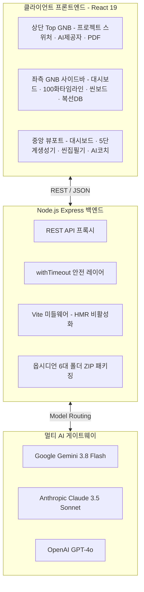
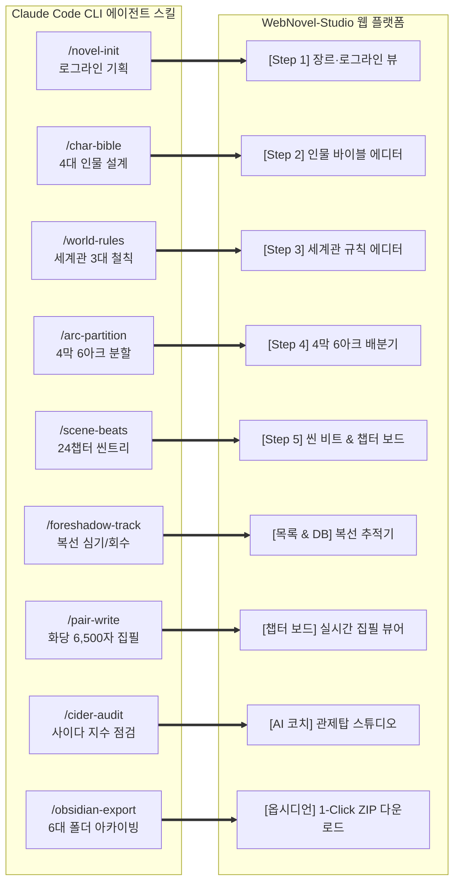

# WebNovel-Studio (웹소설 공학적 창작 & 제작 플랫폼)

> **"클로드 코드(Claude Code)의 스킬(Skills) 체계를 웹 GUI 워크스페이스로 승화시키다."**  
> 100화 완결 4막·6아크·24챕터 공학적 플롯 엔진, 실시간 집필 관제 대시보드, 복선/미결 추적기, 멀티 모델(Gemini · Claude · OpenAI) AI 페어 라이팅 코치가 통합된 차세대 전문 웹소설 창작 플랫폼

[](https://opensource.org/licenses/MIT)
[](https://www.typescriptlang.org/)
[](https://react.dev/)
[](https://expressjs.com/)
[](https://tailwindcss.com/)

---

## 📑 종합 기획 마스터 목차
1. [기획 총괄: Claude Code Skills ↔ WebNovel-Studio 구현 대비표](#1-기획-총괄-claude-code-skills--webnovel-studio-구현-대비표)
2. [11단계 공학적 웹소설 집필 파이프라인 종합표](#2-11단계-공학적-웹소설-집필-파이프라인-종합표)
3. [4막 6아크 24챕터 100화 정량 플롯 마스터표](#3-4막-6아크-24챕터-100화-정량-플롯-마스터표)
4. [인물 바이블 & 세계관 3대 철칙 설계표](#4-인물-바이블--세계관-3대-철칙-설계표)
5. [화당 분량 통제 · 씬 분할 · 클리프행어 규격표](#5-화당-분량-통제--씬-분할--클리프행어-규격표)
6. [복선(Foreshadowing) & 떡밥 라이프사이클 관리표](#6-복선foreshadowing--떡밥-라이프사이클-관리표)
7. [Mermaid.js 핵심 구조도 모음](#7-mermaidjs-핵심-구조도-모음)
8. [메인 관제 대시보드 UI/UX 디자인 상세 명세](#8-메인-관제-대시보드-uiux-디자인-상세-명세-dashboard-design-spec)
9. [7대 코어 UI/UX 디자인 시안 구조표](#9-7대-코어-uiux-디자인-시안-구조표)
10. [인터랙티브 버튼 구현 명세표](#10-인터랙티브-버튼-구현-명세표)
11. [옵시디언 6대 표준 폴더 매핑표](#11-옵시디언-6대-표준-폴더-매핑표)
12. [서버 안정성 & 장애 방어 기술 명세](#12-서버-안정성--장애-방어-기술-명세)

---

## 1. 기획 총괄: Claude Code Skills ↔ WebNovel-Studio 구현 대비표

클로드 코드(Claude Code)의 CLI 에이전트 스킬(Task Rules, Slash Commands, Markdown Knowledge Base) 체계와 본 WebNovel-Studio 플랫폼의 GUI 기능 구현 대비표입니다.

| 단계 | Claude Code CLI 스킬 | WebNovel-Studio 웹 플랫폼 컴포넌트 | GUI 제공 기능 및 엔지니어링 명세 | 산출물 / 데이터 형식 |
|:---:|:---|:---|:---|:---|
| **01** | `/novel-init` | **[Step 1] 장르·로그라인 뷰** (`Step1Logline.tsx`) | 3원소 공식(신분+결핍+보상) 자동 검증, AI 흥행 키워드 칩 | 로그라인, 장르 비율 JSON |
| **02** | `/char-bible` | **[Step 2] 인물 바이블 에디터** (`Step2Characters.tsx`) | 4대 인물(주인공, 적대자, 조력자, 트릭스터) 결핍 및 아크 궤적 | 인물 바이블 JSON / MD |
| **03** | `/world-rules` | **[Step 3] 세계관 규칙 에디터** (`Step3World.tsx`) | 세계관 3대 철칙(등가교환, 사회 계급, 페널티 한계선) 설정 | 세계관 설정 문서 MD |
| **04** | `/arc-partition` | **[Step 4] 4막 6아크 배분기** (`Step4Arcs.tsx`) | 발단-전개-위기-절정-결말 100화 정량 회차 자동 분할 | 4막 6아크 마스터 플롯 |
| **05** | `/scene-beats` | **[Step 5] 씬 비트 트리** (`Step5SceneTree.tsx`) | 챕터당 4~5개 기승전결 씬 분할 및 100화 씬 구조화 | 24챕터 씬트리 JSON |
| **06** | `/foreshadow-track` | **[목록 & DB] 복선 추적기** (`TabLists.tsx`) | 심은 회차(Plant) ↔ 회수 회차(Payoff) 1:1 매핑 및 미회수 경고 | 복선 DB 테이블 & 게이지 |
| **07** | `/pair-write` | **[챕터 보드] 씬 집필기** (`TabChapter.tsx`) | 화당 6,500자 분량 통제, 기승전결 4단 칸반 씬 집필 | 씬별 초고 및 본문 MD |
| **08** | `/cider-audit` | **[AI 코치] 관제탑 스튜디오** (`AiCoachPage.tsx`) | 사이다 지수 판정, 엔딩 클리프행어 점검, 1-Click 본문 치환 | AI 진단 리포트 & Diff |
| **09** | `/obsidian-export` | **[옵시디언] 워크스페이스 모달** (`WorkspaceModal.tsx`)| 1-기획문서부터 6-덜어내기까지 100% 호환 마크다운 ZIP 다운로드 | `WebNovel-Obsidian.zip` |
| **10** | `/pdf-report` | **[기획서 PDF 뷰어]** (`PdfExportModal.tsx`) | A4 규격 공식 기획서, 전체 개념도, 디자인 시안 인쇄/저장 | ISO 216 A4 PDF 리포트 |
| **11** | `/git-sync` | **[GitHub 동기화]** (`GitSyncModal.tsx`) | 원격 저장소(`main` 브랜치) 1-Click 푸시 및 전체 소스 ZIP 백업 | GitHub Repository Push |

---

## 2. 11단계 공학적 웹소설 집필 파이프라인 종합표

| 순번 | 파이프라인 단계명 | 핵심 공학 공식 및 작성 원칙 | 검증 및 품질 관리(QA) 기준 | 추천 AI 모델 |
|:---:|:---|:---|:---|:---:|
| **Step 01** | **로그라인 수립** | `[주인공 상태] + [극단적 결핍/위기] + [독창적 보상]` | 3초 이내에 독자가 흥미를 느끼는가? (3원소 필수) | Gemini 3.8 Flash |
| **Step 02** | **4대 인물 바이블** | 주인공·적대자·조력자·트릭스터 4각 구도 확립 | 각 인물의 욕망과 결핍이 정면으로 충돌하는가? | Claude 3.5 Sonnet |
| **Step 03** | **세계관 3대 철칙** | 등가교환 법칙, 계급 사회 질서, 치트키 페널티 | 힘의 인플레이션 및 설정 모순을 원천 차단하는가? | OpenAI GPT-4o |
| **Step 04** | **4막 6아크 분할** | 100화 완결을 보증하는 16/16/18/18/16/16화 정량 배분 | 중간 늘어짐(슬럼프 구간) 없이 텐션이 지속되는가? | Gemini 3.8 Flash |
| **Step 05** | **24챕터 씬 비트** | 챕터당 4~5개 기(起)·승(承)·전(轉)·결(結) 씬 트리 | 매 씬마다 주인공의 상태 변화(Status Shift)가 있는가? | Gemini 3.8 Flash |
| **Step 06** | **복선 심기 & 회수** | 심은 챕터 ↔ 회수 예정 챕터 1:1 라이프사이클 매핑 | 80화 진입 전 미회수 떡밥이 0건으로 통제되는가? | OpenAI GPT-4o |
| **Step 07** | **화당 6,500자 통제** | 씬당 1,300자 블록 결합, 모바일 3~4줄 단락 호흡 | 대화:서술 비율 5:5 유지 및 스크롤 피로도 최소화 | Claude 3.5 Sonnet |
| **Step 08** | **엔딩 클리프행어** | 발각 위기, 반전 대사, 압도적 등장 3대 후크 의무화 | 매 씬/회차 마지막 문장에서 다음 화 결제를 유도하는가? | Gemini 3.8 Flash |
| **Step 09** | **사이다/고구마 텐션** | 고구마(위기/억압)는 2화 이내 해소, 2배의 사이다 보상 | 독자의 스트레스 누적 없이 카타르시스가 발생하는가? | Claude 3.5 Sonnet |
| **Step 10** | **AI 페어 라이팅 퇴고**| 어색한 번역투 교정, 캐릭터 보이스(말투) 일관성 검수 | 작가 고유의 문체와 인물의 개성이 보존되는가? | Claude 3.5 Sonnet |
| **Step 11** | **다중 포맷 패키징** | 옵시디언 6대 폴더, Word(.doc), A4 PDF 공식 규격화 | 플랫폼 종속 없이 작가의 평생 자산으로 보존되는가? | Express 백엔드 |

---

## 3. 4막 6아크 24챕터 100화 정량 플롯 마스터표

| 막 (Act) | 아크 코드 / 명칭 | 챕터 범위 | 회차 범위 | 주요 서사 기능 | 사이다 & 텐션 설계 규칙 |
|:---|:---|:---:|:---:|:---|:---|
| **제1막: 발단** | **ARC-01: 각성과 시작** | ch01 ~ ch04 | 01 ~ 16화 | 주인공의 처절한 결핍 노출, 이변의 발생, 고유 능력 각성 | 4화 이내 1차 즉각 보상, 떡밥 #1 살포 |
| **제2막: 전개** | **ARC-02: 급성장과 첫 충돌** | ch05 ~ ch08 | 17 ~ 32화 | 로컬 라이벌과의 정면 충돌, 능력의 진가 증명 | 30화 전후 중간보스 격파 (압도적 사이다) |
| | **ARC-03: 세계관의 확장** | ch09 ~ ch12 | 33 ~ 50화 | 메이저 리그/상위 세력 진입, 흑막의 그림자 포착 | 거대 음모 암시, 핵심 복선 #2 심기 |
| **제3막: 위기/절정** | **ARC-04: 배신과 최대 위기** | ch13 ~ ch16 | 51 ~ 68화 | 믿었던 조력자의 이탈, 사면초가 위기, 주인공의 고립 | 고구마 분량 최대 2화 제한, 반격 실마리 확보 |
| | **ARC-05: 대반격과 각성** | ch17 ~ ch20 | 69 ~ 84화 | 묵혀둔 복선 #1, #2 연쇄 폭발 회수, 극한의 카타르시스 | 적 세력 붕괴, 사이다 지수 95% 이상 폭발 |
| **제4막: 결말** | **ARC-06: 최종 결전과 완결** | ch21 ~ ch24 | 85 ~ 100화 | 최종 흑막과의 결전, 세계관 3대 미결 과제 완전 종결 | 에필로그, 주인공의 궁극적 목표 달성 및 후일담 |

---

## 4. 인물 바이블 & 세계관 3대 철칙 설계표

### 4.1 4대 핵심 등장인물 설계표
| 역할 구분 | 필수 서사 기능 | 내면의 핵심 결핍 | 외적 궁극 목표 | 아크별 전환 궤적 (Trajectory) |
|:---|:---|:---|:---|:---|
| **주인공 (Protagonist)** | 독자의 감정 이입 주체, 사건의 능동적 주도자 | 가족의 상실 / 하급자의 무력감 | 세계 유일의 신화급 도달 | 멸시받는 약자 ➜ 냉철한 전략가 ➜ 절대자 |
| **적대자 (Antagonist)** | 주인공의 가치관과 정면 충돌하는 거대한 벽 | 인정 욕구의 왜곡 / 광기 어린 오만 | 기존 세계관 질서의 독점 | 오만한 권력자 ➜ 광기 어린 집착 ➜ 몰락 |
| **조력자 (Ally)** | 주인공의 결핍(자금, 정보, 지략) 보완 및 유대 | 신체적 한계 / 과거의 실패 트라우마 | 주인공의 성공을 통한 구원 | 회의적 방관자 ➜ 충성스러운 동반자 ➜ 핵심 지지자 |
| **트릭스터 (Trickster)** | 서사 긴장 이완, 예상치 못한 반전 변수 창출 | 정착할 수 없는 방랑벽 / 탐욕 | 재미와 단기적 실리 추구 | 의심스러운 기회주의자 ➜ 결정적 순간의 조력자 |

### 4.2 세계관 3대 철칙 설계표
| 철칙 번호 | 철칙 명칭 | 구체적 적용 규칙 | 파괴 시 발생하는 부작용 및 방어 메커니즘 |
|:---:|:---|:---|:---|
| **철칙 1** | **등가교환의 법칙** | 강력한 이능력(스킬) 사용 시 반드시 비례하는 대가(마력 고갈, 수명 감소, 디버프) 지불 | 파워 인플레이션 방지, 승리의 성취감 극대화 |
| **철칙 2** | **사회 계급 및 서열 질서** | 길드 서열, 헌터 등급, 가문 서열 등 명확한 위계 시스템 존재 | 주인공의 단계별 승급에 따른 시각적 카타르시스 보장 |
| **철칙 3** | **치트키의 한계선** | 주인공의 특수 권능(시스템 윈도우 등)도 만능이 아니며 쿨타임과 제약 조건 존재 | 긴장감 소멸(데우스 엑스 마키나) 방어, 전략적 두뇌 싸움 유도 |

---

## 5. 화당 분량 통제 · 씬 분할 · 클리프행어 규격표

| 구성 단위 | 표준 분량 규격 | 세부 구성 요소 | 모바일 스크롤 최적화 원칙 |
|:---|:---:|:---|:---|
| **1개 챕터 (Chapter)** | 약 24,000 ~ 26,000자 | 4개 씬(기·승·전·결) 결합 (약 4화 분량) | 챕터 엔딩 시 대규모 국면 전환 |
| **1개 회차 (Episode)** | 5,500 ~ 6,500자 (공백 포함) | 1~2개 씬 블록, 3~4줄 단락 호흡 | 대화 50% : 서술 50% 황금 비율 유지 |
| **기(起) 씬 (Scene 1)** | 1,200 ~ 1,500자 | 새로운 사건 제시, 현장 공간 분위기 묘사 | 도입 10줄 이내 독자 시선 집중 |
| **승(承) 씬 (Scene 2)** | 1,400 ~ 1,800자 | 장애물의 등장, 갈등 고조, 1차 격돌 | 감정선의 단계적 압박 |
| **전(轉) 씬 (Scene 3)** | 1,400 ~ 1,800자 | 예상치 못한 반전, 적의 기습, 위기 최고조 | 고구마 텐션 억제, 반격 카드 암시 |
| **결(結) 씬 (Scene 4)** | 1,200 ~ 1,500자 | 극적인 타개, 보상 획득, **엔딩 클리프행어** | **다음 화 결제 유도 후킹 문장 배치 필수** |

### 5.1 3대 엔딩 클리프행어(Hook) 기법
1. **발각의 위기형**: 비밀 행동 중 예상치 못한 침입자 발생 (*"그 순간, 굳게 닫혔던 문이 열렸다."*)
2. **반전의 대사형**: 인물의 숨겨진 정체나 배신 폭로 (*"네가 찾는 배신자, 바로 나야."*)
3. **압도적 등장형**: 감당 불가능한 상위 존재의 난입 (*"연기 속에서 걸어 나온 것은 10년 전 죽었다던 스승이었다."*)

---

## 6. 복선(Foreshadowing) & 떡밥 라이프사이클 관리표

| 복선 구분 | 심기 회차 (Plant) | 잠복 기간 | 회수 회차 (Payoff) | 미회수 시 위험도 및 시스템 알림 |
|:---|:---:|:---:|:---:|:---|
| **단기 복선 (Short-term)** | 해당 챕터 기(起) 씬 | 1 ~ 3화 | 해당 챕터 결(結) 씬 | 씬 개연성 훼손 (경고 레벨: 낮음) |
| **중기 복선 (Mid-term)** | 해당 아크 1~2챕터 | 10 ~ 15화 | 해당 아크 클라이맥스 씬 | 아크 카타르시스 부족 (경고 레벨: 중간) |
| **장기 복선 (Long-term)** | 1~2막 (01~40화) | 30 ~ 50화 | 3~4막 (70~85화 대반격) | **설정 붕괴 및 독자 대규모 이탈 (경고 레벨: 최고)** |

---

## 7. Mermaid.js 핵심 구조도 모음

### 7.1 전체 시스템 아키텍처 다이어그램


### 7.2 Claude Code Skills ↔ WebNovel-Studio GUI 매핑 흐름도


---

## 8. 메인 관제 대시보드 UI/UX 디자인 상세 명세 (Dashboard Design Spec)

메인 관제 대시보드는 작가가 플랫폼에 접속했을 때 가장 먼저 마주하는 핵심 관제탑입니다. **다크 네이비 그라디언트 히어로 배너**, **4대 핵심 KPI 카드**, **장르별 템플릿 카드 그리드**, **3-Column 연재 인텔리전스 분석단**으로 구성되어 있습니다.

### 8.1 대시보드 와이어프레임 구조도 (Visual Mockup)

```
+-------------------------------------------------------------------------------------------------------------------+
| [DARK GRADIENT HERO BANNER]  bg-gradient-to-r from-slate-900 via-blue-950 to-indigo-950                          |
|  - 라벨: [WebNovel-Studio 관제 센터]  11단계 공학적 웹소설 집필 시스템                                                |
|  - 타이틀: 웹소설 창작 프로젝트 대시보드                                                                          |
|  - 액션: [+ 새로운 웹소설 작성하기 (Blue)]  [🤖 AI API 설정 (Dark Slate)]                                           |
|                                                                                                                   |
|  [4 Key Summary KPI Cards]                                                                                        |
|  +--------------------+--------------------+--------------------+-----------------------------------------------+  |
|  | 📚 총 관리 소설     | 📈 누적 비축 화수    | 📝 총 집필 글자수    | 🤖 활성 AI 엔진                               |  |
|  | 3 편               | 14 화 (목표 100화) | 77,000 자          | GEMINI · 3.8 Flash (스위처 클릭 가능)        |  |
|  +--------------------+--------------------+--------------------+-----------------------------------------------+  |
+-------------------------------------------------------------------------------------------------------------------+

+-------------------------------------------------------------------------------------------------------------------+
| [PROJECT CARDS GRID]  (3-Column Responsive Grid)                                                                  |
|                                                                                                                   |
|  [Card 1: 재벌 복수극]             [Card 2: 현대 헌터/성좌]           [Card 3: 로맨스 판타지]                         |
|  - 👑 재벌 복수극 템플릿 (Amber)   - ⚔️ 현대 헌터 템플릿 (Blue)       - ✨ 로맨스 판타지 템플릿 (Rose)                |
|  - 《재벌집 망나니의 복수록》      - 《SS급 소환사는 홀로 헌팅》     - 《시한부 악녀는 남주의 집착을 사양합니다》   |
|  - 시놉시스 스니펫 박스           - 시놉시스 스니펫 박스           - 시놉시스 스니펫 박스                         |
|  - 오픈 비축 진행도: 14/100화 (14%)- 오픈 비축 진행도: 8/100화 (8%) - 오픈 비축 진행도: 2/100화 (2%)               |
|  - [선택하기 (작품보기로 이동)]   - [선택하기 (작품보기로 이동)]   - [선택하기 (작품보기로 이동)]                 |
+-------------------------------------------------------------------------------------------------------------------+
|  [+ 새로운 웹소설 기획 추가 (Dotted 2-border Box)] 100화 4막·6아크 공학적 템플릿 원클릭 생성                         |
+-------------------------------------------------------------------------------------------------------------------+

+-------------------------------------------------------------------------------------------------------------------+
| [하단 상세 관제 & 연재 인텔리전스 (3-Column Intelligence Grid)]                                                    |
|                                                                                                                   |
|  [Column 1: 11단계 파이프라인 진척도]  [Column 2: 4막 6아크 플롯 방어율]  [Column 3: 차기 챕터 & 복선 회수 계획]    |
|  - 01발상 ~ 11아크검토 단계 게이지    - ARC-01(각성) ~ ARC-06(완결) 텐션 - 심은 떡밥 회수 마감일 및 클리프행어 체크 |
+-------------------------------------------------------------------------------------------------------------------+
```

### 8.2 대시보드 4대 핵심 KPI 지표 명세표

| KPI 지표명 | 컴포넌트 위치 | 수치 데이터 소스 | 사용자 인터랙션 & 동작 메커니즘 | 시각적 피드백 & 스타일 토큰 |
|:---|:---:|:---|:---|:---|
| **총 관리 소설** | 히어로 배너 좌측 1번 | `projects.length` | 클릭 시 `MetricEditModal` 호출하여 전체 프로젝트 목록/메트릭 일괄 편집 | `text-blue-400`, 호버 시 테두리 블루 하이라이트 |
| **누적 비축 화수** | 히어로 배너 2번 | `totalReservedEpisodes` | 클릭 시 현재 소설의 비축 화수(100화 목표) 인라인 다이얼로그 오픈 | `text-emerald-400`, 호버 시 에메랄드 테두리 |
| **총 집필 글자수** | 히어로 배너 3번 | `totalWords.toLocaleString()` | 클릭 시 총 글자 수 수치 직접 수정 및 화당 평균 글자 수 계산 | `text-amber-400`, 천 단위 쉼표 포맷팅 |
| **활성 AI 엔진** | 히어로 배너 4번 | `aiSettings.activeProvider` | 클릭 시 `AiSettingsModal` 오픈하여 Claude / OpenAI / Gemini 즉시 변경 | `text-indigo-300`, 활성 모델 뱃지 표시 |

### 8.3 프로젝트 카드 템플릿별 비주얼 시스템 명세표

| 장르 템플릿 | 배지 아이콘 | 배지 텍스트 | 컬러 테마 토큰 | 대상 독자층 및 서사 공식 |
|:---|:---:|:---|:---|:---|
| **재벌 복수극** | `Crown` (왕관) | 재벌 복수극 템플릿 | `text-amber-800 bg-amber-50 border-amber-300` | 회빙환(회귀·빙의·환생), 지분 전쟁, 피도 눈물도 없는 두뇌 싸움 |
| **현대 헌터/성좌** | `Sword` (검) | 현대 헌터/성좌 템플릿 | `text-blue-700 bg-blue-50 border-blue-300` | 상태창 각성, 게이트 레이드, 성좌들의 후원 및 압도적 무력 독식 |
| **로맨스 판타지** | `Sparkles` (반짝임)| 로맨스 판타지 템플릿 | `text-rose-700 bg-rose-50 border-rose-300` | 시한부 악녀 빙의, 황태자/공작과의 계약 결혼, 역하렘 집착 서사 |
| **정통 무협** | `Flame` (불꽃) | 정통 무협 템플릿 | `text-orange-700 bg-orange-50 border-orange-300` | 기연 획득, 혈교/마교 토벌, 협(俠)의 실천과 문파 부흥기 |
| **자유 설계** | `Layers` (레이어) | 자유 설계 템플릿 | `text-emerald-700 bg-emerald-50 border-emerald-300`| SF, 아포칼립스, 게임 판타지 등 작가 고유 커스텀 세계관 |

### 8.4 프로젝트 카드 인터랙션 및 상태 전환 규칙

1. **카드 바디 클릭 (Card Selection)**:
   - 해당 카드가 `selectedCardId`로 지정되며 `border-2 border-blue-600 ring-4 ring-blue-500/20 shadow-md`가 활성화됩니다.
   - 바로 아래에 [현재 활성화된 소설] 요약 바가 즉각 슬라이드 노출됩니다.
2. **진행률 영역 클릭 (Progress Metric Edit)**:
   - `e.stopPropagation()` 방어로 카드 선택과 분리되며, 비축 화수 및 목표 회차를 수정하는 `MetricEditModal`이 팝업됩니다.
3. **[선택하기 (작품보기로 이동)] 버튼 클릭**:
   - `onSelectProject(project.id)`가 실행되어 전역 상태(Active Project)가 동기화되고 **타임라인 마스터 뷰(Timeline View)**로 즉시 라우팅됩니다.
4. **[+ 새로운 웹소설 기획 추가] 점선 카드 클릭**:
   - 100화 4막 6아크 공학적 템플릿을 생성하는 5단계 소설 생성 마법사가 호출됩니다.

### 8.5 하단 연재 인텔리전스 3-Column 분석단 명세

| 컬럼 번호 | 분석 영역 | 데이터 필드 및 시각화 | 연재 작가를 위한 핵심 기능 |
|:---:|:---|:---|:---|
| **Column 1** | **11단계 파이프라인 진척도** | `stagesDone / 11` (퍼센티지 게이지) | 발상부터 아크 검토까지 현재 소설이 어떤 기획 단계에 머물러 있는지 진단 |
| **Column 2** | **4막 6아크 플롯 방어율** | 아크별 완료 챕터 / 목표 챕터 프로그레스 | 특정 아크에서의 분량 초과나 조기 소진을 방지하고 100화 균형 유지 |
| **Column 3** | **차기 챕터 & 복선 회수 계획** | 잔여 미결 떡밥 카운트 & 클리프행어 체크 | 마감 전 반드시 회수해야 할 복선과 엔딩 후킹 포인트를 자동 체크리스트로 제시 |

---

## 9. 7대 코어 UI/UX 디자인 시안 구조표

| 시안 번호 | 화면 명칭 | 활성 탭 / 모달 키 | 주요 레이아웃 특징 및 디자인 토큰 | 인터랙션 및 조작 요소 |
|:---:|:---|:---:|:---|:---|
| **시안 1** | **메인 관제 대시보드** | `activeTab === 'dashboard'` | 상단 4대 KPI 카드, 중앙 아크별 원형 프로그레스 바, 하단 소설 캐러셀 | 소설 카드 클릭 전환, 새 소설 빠른 시작 |
| **시안 2** | **5단계 소설 생성 스튜디오** | `activeTab === 'new-project'`| 상단 5단 스텝 인디케이터, AI 추천 칩, 단계별 입력 폼 | 원클릭 AI 플롯 생성, 1~5단계 순차 잠금 해제 |
| **시안 3** | **4막 6아크 마스터 타임라인**| `activeTab === 'timeline'` | 100화 전편을 가로/세로 6대 아크 카드로 시각화 | 아크별 진행률 표시, 챕터 세부 정보 팝오버 |
| **시안 4** | **24챕터 씬 보드 집필기** | `activeTab === 'chapter'` | 좌측 챕터 리스트, 중앙 4단 기승전결 씬 칸반 보드 | 씬 카드 드래그/클릭 편집, 글자 수 실시간 갱신 |
| **시안 5** | **복선 & 떡밥 추적기 DB** | `activeTab === 'lists'` | 회수율 원형 게이지, 심기/회수 매핑 데이터 그리드 | 복선 상태(심음/회수완료) 토글, 미회수 필터링 |
| **시안 6** | **AI 페어 라이팅 코치** | `activeTab === 'ai-coach'` | 인디고 전용 테마, 3단계 감수 모드, 원문 vs AI 개선안 Diff | 원클릭 본문 치환 버튼, 사이다 지수 측정 |
| **시안 7** | **옵시디언 워크스페이스** | `WorkspaceModal` | 6대 폴더 마크다운 파일 트리 뷰어, 코드 하이라이트 | 파일 내용 미리보기, 1-Click ZIP 다운로드 |

---

## 9. 인터랙티브 버튼 구현 명세표

| 버튼 명칭 | 위치 | 연결 핸들러 / API | 내부 동작 메커니즘 & 상태 피드백 |
|:---|:---:|:---|:---|
| **대시보드 HOME** | 좌측 GNB | `onSelectTab('dashboard')` | 전체 소설 통계 및 프로젝트 카드뷰로 전환 (파란색 하이라이트) |
| **새로운 웹소설 작성하기** | 좌측 GNB / 대시보드 | `onSelectTab('new-project')` | 5단계 생성기 폼 초기화 및 파이프라인 진입 (그라디언트 링 애니메이션) |
| **기획서 PDF 뷰어** | Top GNB / 사이드바 | `setIsPdfModalOpen(true)` | A4 규격 완성형 리포트 모달 오픈, 실시간 필터 탭 제공 |
| **PDF로 즉시 저장 / 인쇄** | PDF 모달 상단 | `window.print()` | `@media print` A4 페이지 분할 최적화 후 시스템 인쇄/PDF 저장 호출 |
| **워드(.doc) 다운로드** | 좌측 도구 메뉴 | `exportToWordDoc(project)` | 전체 100화 기획서를 MS Word 호환 HTML Blob으로 생성 후 다운로드 |
| **옵시디언 워크스페이스** | Top GNB / 사이드바 | `setIsWorkspaceModalOpen(true)` | 옵시디언 6대 표준 폴더 트리 브라우저 팝업 |
| **옵시디언 ZIP 다운로드** | 옵시디언 모달 | `/api/export-obsidian-zip` | 백엔드에서 6대 폴더를 `.zip`으로 압축하여 즉시 전송 |
| **AI 단계별 생성 (1~5단계)**| 5단계 생성기 뷰 | `handleGenerateStep(n)` | 프롬프트 엔지니어링 체인 실행 및 결과물 폼에 자동 주입 |
| **AI 개선안 본문 즉시 적용**| AI 코치 뷰 | `handleApplyAiTextToScene()` | AI가 퇴고/교정한 텍스트로 해당 씬 본문을 1-Click 치환 |
| **프로젝트 전환 셀렉터** | Top GNB / 사이드바 | `handleSelectProject(id)` | 인물, 아크, 복선, 챕터 데이터를 전역 상태로 즉각 동기화 |
| **설정 (AI 모델 & API)** | Top GNB / 사이드바 | `setIsSettingsModalOpen(true)` | Gemini/Claude/OpenAI API 키 등록 및 활성 모델 변경 |

---

## 10. 옵시디언 6대 표준 폴더 매핑표

| 디렉토리 경로 | 폴더 명칭 | 수록 마크다운 문서 및 데이터 | 호환 플랫폼 및 용도 |
|:---|:---|:---|:---|
| `1-기획문서/` | 기획 바이블 | `01-계획서.md`, `02-세계관.md`, `03-캐릭터바이블.md`, `04-스토리구조.md`, `05-문체가이드.md` | 옵시디언 그래프 뷰 핵심 노드 |
| `2-챕터문서/` | 챕터 계획 | `ch01-챕터계획.md` ~ `ch24-챕터계획.md` (기승전결 씬 분할) | 챕터별 플롯 인과관계 추적 |
| `3-집필문서/` | 씬별 본문 초고 | `ch01/` ~ `ch24/` 폴더 내 `s01.md` ~ `s14.md` | 씬 단위 모듈식 집필 및 AI 퇴고 |
| `4-연재본/` | 화별 완성 원고 | `ch01.md` ~ `ch24.md` (화당 6,500자 병합 완결본) | 문피아, 카카오페이지, 네이버시리즈 업로드 |
| `5-검토기록/` | 감수 및 진단 리포트 | `씬구성진단.md`, `퇴고체크리스트.md`, `페이싱리포트.md` | AI 코칭 이력 및 사이다 지수 기록 |
| `6-덜어내기/` | 컷씬 아카이브 | 분량 조절 및 템포 관리를 위해 잘라낸 씬 보관 | 외전 및 후일담 활용 소재 |
| 루트 파일 | 대시보드 캐시 | `aiwc-dashboard.json` | 플랫폼 데이터 무결성 동기화 캐시 |

---

## 11. 서버 안정성 & 장애 방어 기술 명세

| 장애 유형 및 리스크 | 적용 방어 기술 | 구현 파일 및 상세 매커니즘 | 보장 효과 |
|:---|:---|:---|:---|
| **Vite WebSocket 닫힘 에러** | `hmr: false` 미들웨어 고정 | `server.ts` & `vite.config.ts` | 클라우드 프리뷰 컨테이너의 WebSocket 충돌 및 에러 오버레이 100% 차단 |
| **AI API 응답 지연/먹통** | `withTimeout(promise, ms)` | `server.ts` (3.5s ~ 5s 한도) | 무한 로딩 방지, 타임아웃 시 안전한 지능형 Fallback 응답 반환 |
| **로컬스토리지 데이터 손상** | `ensureProjectIntegrity` | `src/data/projectTemplates.ts` | 누락된 필드를 100화 표준 템플릿 제원으로 자동 마이그레이션 복구 |
